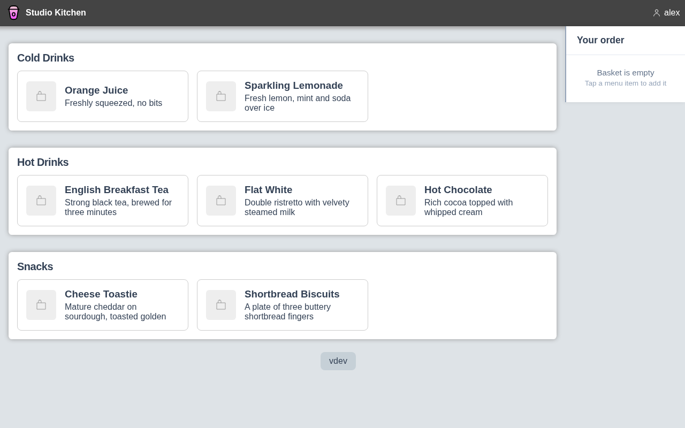
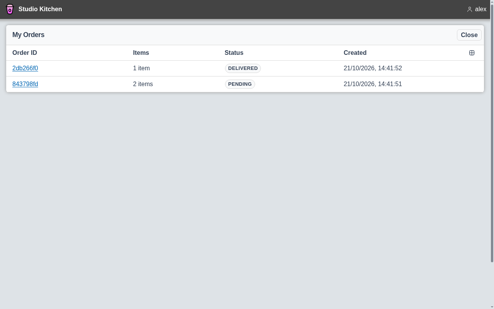
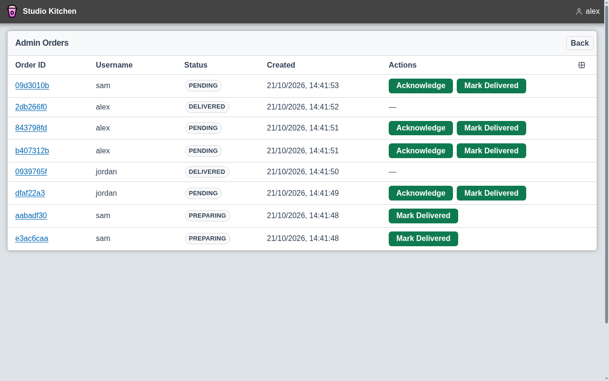
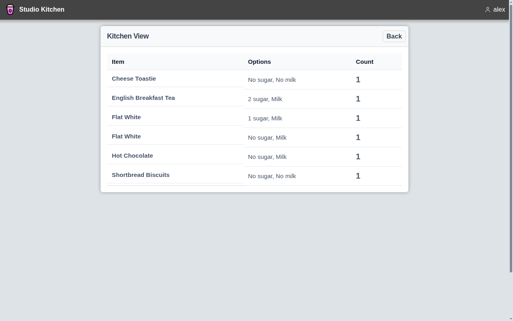
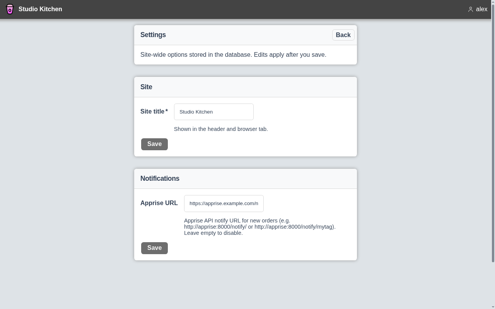

<div align = "center">
  
  <h1>EasyPour</h1>

  Send sips and snacks straight to servers — or your spouse.

[](#none)
[](https://discord.gg/jhYWWpNJ3v)
</div>

## Screenshots

### Menu



Browse drinks and snacks grouped by category, pick sugar and milk, and add them to a basket to send in one order.

### My orders



Follow each of your orders from pending to preparing to delivered, with live status updates.

### Order queue



Staff see every order in one place and move them through preparing and delivered as they make them.

### Kitchen view



Totals of every item across open orders, so whoever is making the round knows exactly what to prepare.

### Settings



Name your site and set an Apprise URL so new orders ping your phone, chat or smart speaker.

Screenshots use fictional test data and are regenerated with `make screenshots`
(see [`var/marketing/screenshots`](var/marketing/screenshots/README.md)).

## Quick Start

```bash
docker pull ghcr.io/jamesread/easypour:latest
docker run -p 9654:9654 -v easypour-config:/config ghcr.io/jamesread/easypour:latest
```

Or with Docker Compose:

```yaml
services:
  easypour:
    image: ghcr.io/jamesread/easypour:latest
    ports:
      - "9654:9654"
    volumes:
      - easypour-config:/config

volumes:
  easypour-config:
```

Run with `docker compose up -d`. To use a host directory for config instead of a named volume, replace the volume with e.g. `- ./config:/config`.

Config (`config.yaml`) and SQLite data (`easypour.db`) live in `/config`. Schema migrations run on container start via sql-migrate. An optional `menu.yaml` in that directory is imported once when the menu table is empty (first boot seed). Use a named volume `-v easypour-config:/config` to persist them, or bind-mount a host dir: `-v /path/to/your/config:/config`.

Older installs that used separate `menu.db`, `orders.db`, and `settings.db` files are migrated into `easypour.db` automatically on startup (existing rows are preserved; legacy files are left in place unused).

Open `http://localhost:9654` for the web UI. Prometheus metrics are served at `/metrics`.

See the [docs](docs/) for configuration, installation, and development guides.

